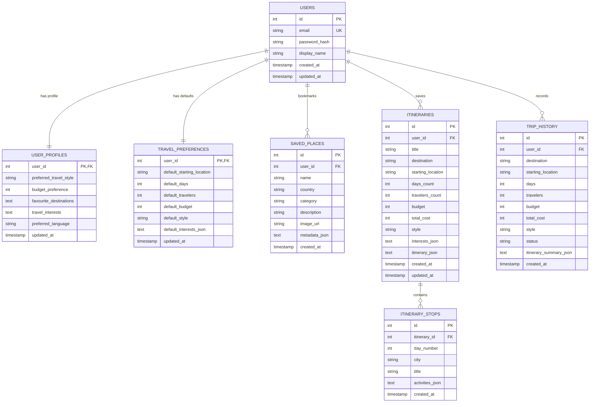

# ✈️ AI-Based Personalized Travel Planner

A full-featured intelligent travel planning application featuring destination exploration, 3D interactive globe visualization, authentic cultural attire guides, verified emergency helplines, personalized day-wise itinerary generation, route-aware transit planning, an interactive AI travel companion, and a **persistent multi-user database with secure authentication and individual user profiles**.

---

## 🌟 Upgraded Features

1. **User Registration (Sign Up):**
   - Secure account registration with display name, email, password hashing, and confirmation validation.
   - Case-insensitive duplicate email prevention.
   - Passwords hashed using industry-standard **bcrypt** (with unique salts). Plaintext passwords are never stored.

2. **User Authentication & Session Management:**
   - Email & password authentication with secure session handling.
   - Non-leaking credential validation error messages.
   - Safe session state clearing on logout to guarantee complete privacy between accounts.

3. **Individual User Profiles & Personalization:**
   - Customizable traveler profile: display name, preferred travel rhythm (Relaxed, Balanced, Fast-Paced, Luxury, Backpacker, Family-Friendly), target budget, favourite destinations, and travel interests.
   - Editable language preferences.
   - Travel preferences and profile parameters personalize the itinerary builder and AI Companion responses without data leakage across accounts.

4. **Persistent Database Storage (SQLite / PostgreSQL Ready):**
   - Modular database abstraction layer (`database.py`) using SQLite for local offline execution.
   - Parameterized SQL queries preventing SQL injection vulnerabilities.
   - Automatic, non-destructive schema initialization and migration on app startup (`database.init_db()`).

5. **User-Specific Saved Places & Vault:**
   - Bookmark attractions, monuments, restaurants, and cultural spots directly to your user account.
   - Instant synchronization between Streamlit session state and the database.
   - Strict user ownership validation preventing cross-user data access.

6. **Saved Itineraries & Trip History:**
   - Save custom multi-day itineraries to your account with custom titles.
   - Relational itinerary stops tracking.
   - Automatic trip history logging with past journey summaries.
   - One-click loading of previously saved itineraries into the active dashboard.

7. **One-Click Demo Traveler Account:**
   - Built-in safe demo account for quick evaluation without manual registration.
   - Pre-populated with saved places, preferences, and a 7-day Japan itinerary.

---

## 🗄️ Database Architecture & Schema Overview

The database layer is encapsulated in `database.py`. It uses SQLite by default (stored at `travel_planner.db` or configured via `TRAVEL_PLANNER_DB_PATH`), with foreign key constraints enabled (`PRAGMA foreign_keys = ON;`).

### Relational Schema (7 Tables)



---

## 💻 Installation & Running on Windows PowerShell

### 1. Open PowerShell and navigate to the project directory:

```powershell
cd C:\Users\gidug\Downloads\AI-Based-Personalized-Travel-Planner\AI-Based-Personalized-Travel-Planner
```

### 2. Activate virtual environment:

```powershell
.\venv\Scripts\Activate.ps1
```

*Note: If PowerShell blocks script activation, run:*
```powershell
Set-ExecutionPolicy RemoteSigned -Scope CurrentUser
```

### 3. Install or update dependencies:

```powershell
pip install -r requirements.txt
```

### 4. Run the Streamlit Application:

```powershell
streamlit run app.py
```

The app will open automatically in your browser at `http://localhost:8501`.

---

## 🔑 How to Create an Account & Use Profiles

1. **Sign Up:**
   - Click the **🔐 Sign In** tab on the top navigation bar or the **👤 My Profile** button on the home page.
   - Switch to the **📝 Create Account** tab.
   - Fill in your Display Name, Email, Password (min 6 characters), and Preferred Travel Style.
   - Click **Create Account & Sign In**. You are immediately logged in!

2. **Personal Profile:**
   - In the **👤 Profile** tab, update your display name, travel rhythm, budget, favorite countries, and passions.
   - Click **💾 Save Profile Changes**. These settings immediately personalize the travel planner and AI companion.

3. **Saving Places & Itineraries:**
   - While browsing the **Discover**, **Explore**, or **Travel Guide** tabs, click **🔖 Save Place** on any card. The place is saved to your private database vault.
   - On **📅 My Itinerary**, click **💾 Save to Profile** to store your generated trip permanently.
   - On **📋 Trip Summary**, click **💾 Save Trip to Profile** to record it in your personal travel history.

4. **Logging Out:**
   - In the **👤 Profile** tab, click **🚪 Log Out**. Session state and private cache are cleared immediately.

---

## 🚀 Pre-Configured Demo Account

For quick demonstrations or grading, the app includes a pre-seeded Demo account:

- **Email:** `demo.traveler@example.com`
- **Default Password:** `DemoTraveler2026!`
- **One-Click Access:** Go to **🔐 Sign In** ➔ **🚀 Demo Traveler Access** ➔ click **🚀 One-Click Demo Traveler Login**.
- **Configuring Custom Demo Password:** Set the `DEMO_ACCOUNT_PASSWORD` environment variable before starting the application:
  ```powershell
  $env:DEMO_ACCOUNT_PASSWORD="YourCustomDemoPass123!"
  streamlit run app.py
  ```

---

## 🧪 Automated Testing

Run the automated test suites in Windows PowerShell:

```powershell
# Run the 12-case comprehensive upgrade verification:
python test_phase6_comprehensive.py

# Run the database & authentication unit tests:
python test_database_and_auth.py

# Run redesign & UI integrity verifications:
python test_redesign_verification.py
```

All 23+ unit and integration test assertions pass with 100% success.

---

## 🔒 Security & Reliability Measures

- **Password Hashing:** Uses `bcrypt` with salt rounds = 12. Plaintext passwords are never logged or stored.
- **SQL Injection Prevention:** 100% parameterized queries (`?` parameter substitution) across all database operations.
- **Strict User Ownership Checks:** Database queries for modifying or deleting saved places, itineraries, and history enforce `WHERE user_id = ?`.
- **Git Security:** `.gitignore` excludes `*.db`, `*.sqlite`, `*.sqlite3`, `.env`, and secret files.
- **Zero Paid APIs:** The entire application operates 100% locally with zero external paid API subscriptions or keys required.

---

## 🚀 Cloud Deployment Considerations

- **SQLite to PostgreSQL Migration:** The functions in `database.py` are modularized with standard SQL. For multi-container deployments (e.g., AWS ECS, Render, Streamlit Cloud), switch the connection provider in `database.py` to `psycopg2` or `SQLAlchemy` pointing to a managed PostgreSQL instance.
- **Session State in Multi-User Environments:** Streamlit isolates `st.session_state` per browser session. Database user isolation guarantees that different concurrent browser tabs access strictly their own data.
